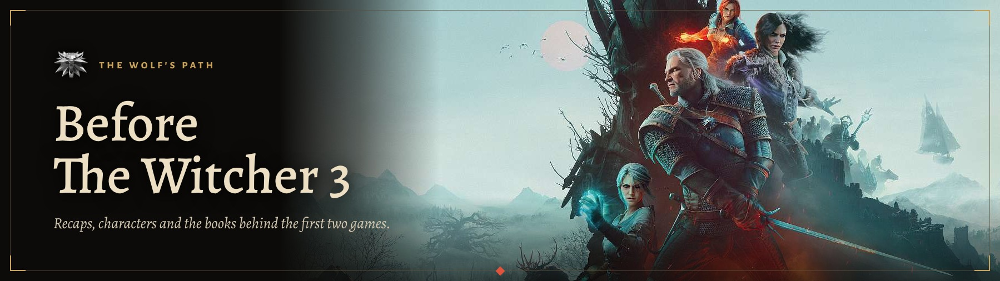

  

A private companion for returning to The Witcher 3. It recaps the first two games, tracks the people who come back, and sets the books against the games, so the third game makes sense without replaying everything.

## What's inside

- **Game recaps.** The Witcher in 10 chapters and The Witcher 2 in 11, each with its own art, a "fork in the path" note where choices split, and what to carry into Witcher 3.
- **Characters.** 24 returning faces with Witcher 3 journal portraits, their history before the Wild Hunt and the one thing to remember about them.
- **Books and games.** 11 comparisons of the saga against the first two games, from Geralt and Yennefer to the Lodge and the Wild Hunt, plus notes on canon and the side games.
- **Reading progress.** Chapters marked as remembered, bookmarks and the last page read, saved in the browser.
- **Search.** Ctrl+K across chapters, characters and comparisons.

## Rules the content follows

- Full spoilers for The Witcher 1 and 2. Nothing from later in Witcher 3.
- Player choices stay as branches. Roche and Iorveth are separate routes and no playthrough is treated as the real one.
- Book spoilers are opt-in and stay hidden behind a switch, including on direct links.
- Every chapter, character and comparison lists its sources.

## Design

Built to feel like Witcher 3's own menus: dark worn surfaces, thin gold-cornered frames, parchment text, gold for anything you can click and red for markers. Game art in its real colours, interface art taken from the game, Alegreya type.

React, plain JavaScript, Vite and CSS. No backend.

## Layout

- `src/data/` recaps, characters, comparisons and their sources
- `src/` app shell, pages, components and styles
- `public/images/` chapter art, banners, portraits, covers and interface art
- `notes/` research behind the recaps

## Credits

The Witcher was created by Andrzej Sapkowski. Game art, logos, screenshots and characters © CD PROJEKT S.A. Book covers © Orbit / Hachette Book Group. Every image and its original source is listed on the app's Sources page. This is a personal, non-commercial project.
